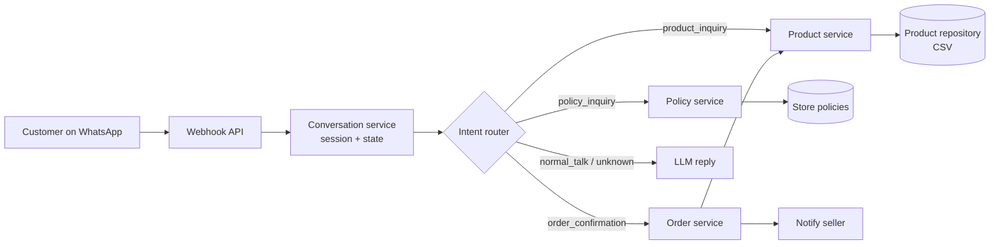

# Lamsa — WhatsApp Customer-Service Bot 🚧

> **Status: in progress.** The product data layer, availability logic and tests are done. The WhatsApp webhook, LLM routing and order flow are being built.

An AI assistant that answers an online store's customers on WhatsApp: checks whether a product is in stock in the size and color they want, answers questions about store policies (shipping, returns, payment), and takes orders, then notifies the seller.

## Planned architecture



## Progress

| Component | File | Status |
|:--|:--|:--|
| Config (TOML, paths resolved from project root) | `app/config.py` | ✅ |
| Product repository (CSV → validated Pydantic models) | `app/data/product_repository.py` | ✅ |
| Product service (lookup, availability, stock) | `app/services/product_service.py` | ✅ |
| Text normalizer | `app/utils/normalizer.py` | ✅ |
| Service builder | `app/main.py` | ✅ |
| Tests + GitHub Actions CI | `tests/`, `.github/workflows/tests.yml` | ✅ |
| Conversation state model | `app/services/conversation_service.py` | 🟡 started |
| Order service | `app/services/order_service.py` | 🟡 started |
| Policy service | `app/services/policy_service.py` | 🟡 started |
| Intent router | `app/routing/intent_router.py` | ⬜ planned |
| LLM client | `app/llm/client.py` | ⬜ planned |
| WhatsApp webhook | `app/api/whatsapp.py` | ⬜ planned |
| Docker image | `Dockerfile` | ⬜ planned |

## Tech stack

Python · Pydantic · pandas · pytest · GitHub Actions

## Run the tests

```bash
git clone https://github.com/h-salah1117/AI-customer-support-for-lamsa.git
cd AI-customer-support-for-lamsa
pip install -r requirements-dev.txt
pytest
```

## Project structure

```
app/
├── api/        # WhatsApp webhook (planned)
├── data/       # repositories: products, policies
├── llm/        # LLM provider client (planned)
├── routing/    # intent router (planned)
├── services/   # product, policy, order, conversation logic
└── utils/      # Arabic/English text normalizer
data/           # sample product catalog and store policies (CSV)
tests/
```
